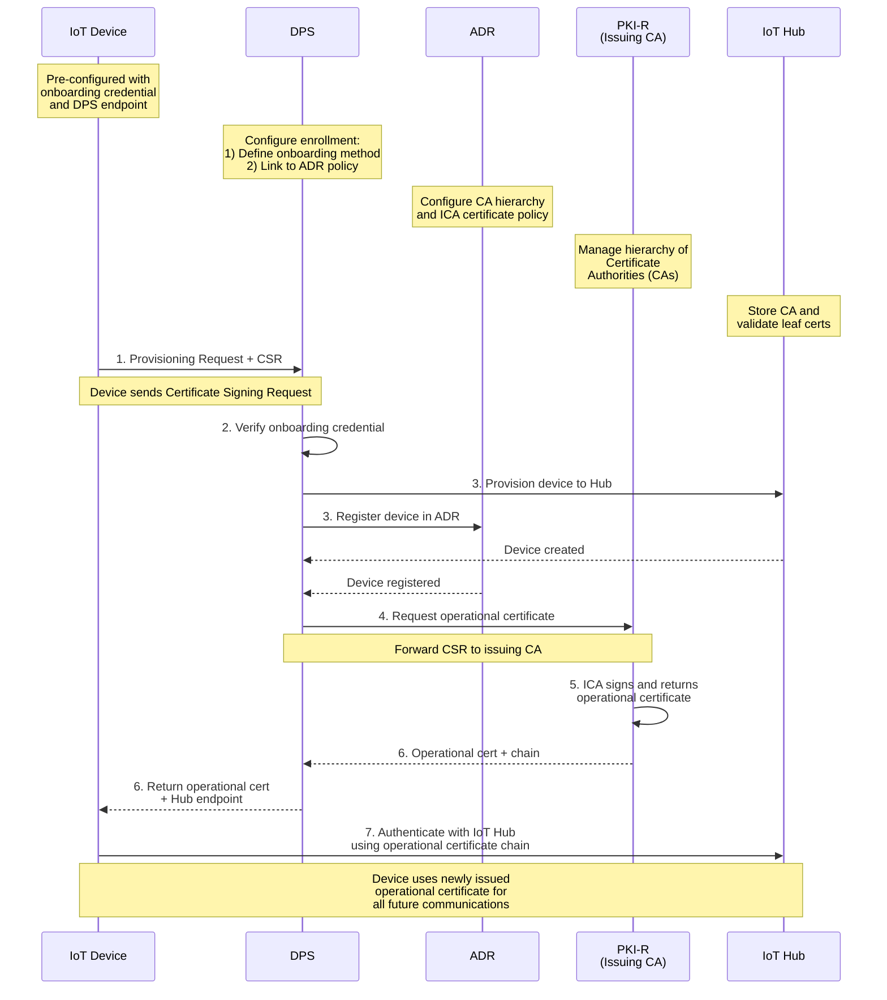

## **Understanding X.509 and CSR Workflows**

> **CLI baseline:** The examples use Azure IoT CLI preview extension
> `azure-iot` **1.0.0b2**, released **6 October 2026**. Last
> reviewed against current Microsoft Learn guidance **5 November 2026**.
> [Release notes](https://github.com/Azure/azure-iot-cli-extension/releases/tag/v1.0.0b2).

---

This series uses Microsoft's **new** certificate management (preview) that enables devices to receive X.509 certificates automatically during provisioning. This post provides a high-level overview and points you to resources for implementation.

> **Preview status:** Microsoft-backed X.509 certificate management is in
> public preview and isn't recommended for production workloads. For details,
> see the [Certificate Management Overview](https://learn.microsoft.com/en-us/azure/iot/iot-certificate-management-overview).

### What's new in this edition?

The two certificate jobs were easy to confuse, so I've made the distinction
clearer: the CA chain created in this walkthrough is for DPS onboarding;
ADR's own CA and policy are used for operational certificates. I've updated
the enrollment example to show where that policy fits. See the
[Introduction](https://www.petecodes.co.uk/iot-hub-with-adr-and-certificate-management-part-1)
for the series-wide changes.

The device also now uses the official unified `Microsoft.Azure.Iot.Device`
**2.0.0-preview4** rather than a custom C# DPS transport. Our adapter keeps the
CSR/key and issued chain durable; both CSR onboarding flows and standard
non-CSR profiles remain. That doesn't add automatic renewal or change our Hub.

---

### Contents

1. [Introduction](https://www.petecodes.co.uk/iot-hub-with-adr-and-certificate-management-part-1)
2. [A DPS Primer](https://www.petecodes.co.uk/iot-hub-with-adr-and-certificate-management-part-2)
3. [Creating DPS, IoT Hub and ADR Instances](https://www.petecodes.co.uk/iot-hub-with-adr-and-certificate-management-part-3)
4. [Understanding X.509 and CSR Workflows (this post)](https://www.petecodes.co.uk/iot-hub-with-adr-and-certificate-management-part-4)
5. [The Device Application](https://www.petecodes.co.uk/iot-hub-with-adr-and-certificate-management-part-5)

## Two Types of Certificates

The new certificate management service makes use of a **two-phase approach**:

### Phase 1: Onboarding Credentials

-   **Purpose:** Device authenticates to DPS during initial provisioning
-   **Options:** X.509 certificates (from third-party CA), symmetric keys, or TPM
-   **Your responsibility:** Pre-install on device before shipment
-   **Lifespan:** Long-lived or used once for initial authentication

### Phase 2: Operational Certificates (Microsoft-Managed)

-   **Purpose:** Device authenticates to IoT Hub for ongoing operations
-   **How it works:** DPS validates the onboarding credential and coordinates
    issuance by the namespace's ADR issuing CA when the device submits a CSR
-   **Generated on:** Device itself (private key never leaves device)
-   **Lifespan:** Set by the assigned ADR certificate policy (1–90 days;
    this series' setup defaults to 30 days); renewal is supported
-   **Security:** Higher security, no key transport

## How It Works

### What's changed in the device code?

The certificate story is the same, but I've moved provisioning to the official
unified `Microsoft.Azure.Iot.Device` **2.0.0-preview4** package. The custom C#
DPS protocol is gone. Our adapter keeps configuration, durable CSR/key/issued
chain files and ADR ARM helpers; `ConnectionClient` owns provisioning and the
Hub connection and `TelemetryClient` shares it. Both CSR onboarding flows and
standard non-CSR symmetric-key/X.509 profiles remain on .NET 10 and our existing
Hub, with its endpoint/profile discovered through DPS.
The setup defaults to an X.509 bootstrap credential and an ADR-issued
operational certificate requested by CSR; the two CA roles remain separate.

See the [SDK feature matrix and design](https://github.com/Azure/azure-iot-sdk/blob/main/dotnet/README.md).
Optional IoT Hub renewal APIs are available, but automatic certificate renewal
isn't implemented in this application. The separate DPS software-updates client
isn't replaced by this provisioning change.

The following diagram shows the complete provisioning flow:



**Key Steps:**

1.  **Device sends provisioning request + CSR** - Device authenticates with onboarding credential and submits Certificate Signing Request
2.  **DPS verifies onboarding credential** - Validates device identity (X.509, symmetric key, or TPM)
3.  **Device provisioned to Hub and registered in ADR** - Device identity created in both services
4.  **Request operational certificate** - DPS uses the CSR to request an operational certificate from the PKI. The PKI validates the CSR and forwards it to the policy (issuing CA) linked to the DPS enrollment.
5.  **ICA signs and returns operational certificate** - Issuing CA issues leaf certificate
6.  **Return operational cert + Hub endpoint** - DPS sends certificate chain back to device
7.  **Device authenticates with IoT Hub** - Device uses new operational certificate for all future connections

## Microsoft-Managed PKI Architecture

Azure Device Registry (ADR) provides a private cloud PKI for each namespace.
Certificate management supports one root CA and up to three intermediate CAs
per namespace. Each intermediate CA can have one certificate policy that sets
the validity of issued device certificates (1–90 days). This series' setup
script defaults to a 30-day policy. The CA signing keys are hardware-protected
by Azure Managed HSM.

ADR synchronizes CA certificates with linked IoT Hubs so the hubs can trust
operational device certificates. You can use a Microsoft cloud root CA or bring
your own external root CA and have ADR manage an intermediate CA.

## Key Features

| Feature | Description |
| :-- | :-- |
| **Algorithms** | ECC (ECDSA) with NIST P-384 curve, SHA-384 hashing |
| **HSM Keys** | Azure Managed HSM (no additional subscription required) |
| **Certificate Validity** | 1–90 days per ADR policy (30-day default in this series' setup script) |
| **Protocols** | HTTP and MQTT during provisioning |
| **Renewal** | Operational certificates can be renewed without reprovisioning |
| **Revocation** | Device certificate revocation is supported; intermediate CA revocation has limits |
| **CA lifecycle** | CA rotation and certificate synchronization are managed through ADR |

## What You'll Be Doing

For this series, you'll create **onboarding credentials** (Phase 1) - we provide automation scripts:

> **Preview Reminder:** Microsoft-backed X.509 certificate management is **new and in public preview**. Operational certificates (Phase 2) are issued by ADR during provisioning and are **not recommended for production workloads** during preview.

### Quick Setup: Automated X.509 Bootstrap Certificates

The [Part 3 setup script](https://www.petecodes.co.uk/iot-hub-with-adr-and-certificate-management-part-3/)
already creates the demo bootstrap CA, device certificate, policy-bound X.509
enrollment and CSR-enabled configuration. You don't need to repeat those steps.
For an existing issuer, see the alternative X.509 profile in the
[setup README](https://github.com/pjgpetecodes/skittlesorter/blob/main/scripts/iot-hub-device-registry/README.md).

### Manual Setup: Step-by-Step (X.509 Bootstrap Certificates)

If you prefer not to use the script, here are the manual steps to create **onboarding credentials** (bootstrap certs) and verify your CA with DPS.

This optional walkthrough uses a separate enrollment and onboarding CA. It
assumes the services and ADR certificate policy from Part 3 already exist; do
not reuse the automated setup's enrollment name or overwrite its certificates.

> **Keep the two CA roles separate:** The root and intermediate certificates
> created below are your device's **onboarding** chain, which DPS uses to
> authenticate the device. They are not the ADR-managed root and intermediate
> CAs that issue the device's short-lived **operational** certificate. The
> operational issuer and policy are created in [Part 3](https://www.petecodes.co.uk/iot-hub-with-adr-and-certificate-management-part-3/)
> and selected separately on the DPS enrollment. See Microsoft's [CA hierarchy](https://learn.microsoft.com/en-gb/azure/iot/concept-managed-ca-hierarchy),
> [managed CA setup](https://learn.microsoft.com/en-gb/azure/iot/how-to-create-policy?tabs=cli),
> and [certificate-policy enrollment steps](https://learn.microsoft.com/en-us/azure/iot/how-to-create-edit-certificate-policy?tabs=cli).

**Prerequisites:**

```powershell
# Verify tools are available
az --version                    # Azure CLI
openssl version                 # OpenSSL
```

If PowerShell shows this error when you run `openssl`:

```powershell
openssl : The term 'openssl' is not recognized as the name of a cmdlet, function, script file, or operable program.
```

Add OpenSSL to your PATH for this session (check if if this is the correct path for your openssl install):

```powershell
$env:Path = "C:\Program Files\OpenSSL-Win64\bin;$env:Path"
```

**1) Set variables and create folders:**

**Set variables:**

```powershell
$unique = "dev001"             # make it unique

$resourceGroup = "<existing-resource-group>"
$dpsName = "<existing-dps-name>"
$registrationId = "$unique-skittlesorter"
$enrollmentGroupName = "$unique-skittlesorter-group"
$certDir = ".\certs\manual-x509-demo"       # choose an unused directory
$adrNamespace = "<adr-namespace>"
$adrIntermediateCaName = "<adr-intermediate-ca-name>"
$adrCertificatePolicyName = "<adr-certificate-policy-name>"
```

**Create root CA folder:**

```powershell
New-Item -ItemType Directory -Path "$certDir\root" -Force | Out-Null
```

**Create intermediate CA folder:**

```powershell
New-Item -ItemType Directory -Path "$certDir\ca" -Force | Out-Null
```

**Create device folder:**

```powershell
New-Item -ItemType Directory -Path "$certDir\device" -Force | Out-Null
```

**2) Create root and intermediate CA:**

**Create root CA certificate (self-signed):**

```powershell
openssl req -x509 -new -nodes -newkey rsa:4096 `
  -keyout "$certDir\root\root-ca.key" `
  -out "$certDir\root\root-ca.pem" `
  -days 3650 -sha256 `
  -subj "/CN=$registrationId-root" `
  -addext "basicConstraints=critical,CA:true,pathlen:1" `
  -addext "keyUsage=critical,keyCertSign,cRLSign" `
  -addext "subjectKeyIdentifier=hash" `
  -addext "authorityKeyIdentifier=keyid:always"
```

**Create intermediate CA private key:**

```powershell
openssl genrsa -out "$certDir\ca\intermediate-ca.key" 4096
```

**Create intermediate CA CSR:**

```powershell
openssl req -new `
  -key "$certDir\ca\intermediate-ca.key" `
  -out "$certDir\ca\intermediate-ca.csr" `
  -subj "/CN=$registrationId-intermediate"
```

**Create intermediate CA extensions file:**

```powershell
@"
[ v3_intermediate ]
basicConstraints = critical,CA:true,pathlen:0
keyUsage = critical, keyCertSign, cRLSign
subjectKeyIdentifier = hash
authorityKeyIdentifier = keyid:always,issuer
"@ | Set-Content -Path "$certDir\ca\intermediate-ext.cnf" -Encoding ASCII
```

**Sign intermediate CA with root CA:**

```powershell
openssl x509 -req `
  -in "$certDir\ca\intermediate-ca.csr" `
  -CA "$certDir\root\root-ca.pem" `
  -CAkey "$certDir\root\root-ca.key" `
  -CAcreateserial `
  -out "$certDir\ca\intermediate-ca.pem" `
  -days 1825 -sha256 `
  -extfile "$certDir\ca\intermediate-ext.cnf" `
  -extensions v3_intermediate
```

3**) Extract certificate thumbprints:**

**Extract root CA thumbprint:**

```powershell
$rootX509 = New-Object System.Security.Cryptography.X509Certificates.X509Certificate2("$certDir\root\root-ca.pem")
$rootThumbprint = $rootX509.Thumbprint
```

**Extract intermediate CA thumbprint:**

```powershell
$caX509 = New-Object System.Security.Cryptography.X509Certificates.X509Certificate2("$certDir\ca\intermediate-ca.pem")
$caThumbprint = $caX509.Thumbprint
```

**4) Upload and verify root CA with DPS:**

**Upload root CA to DPS:**

```powershell
$rootCertName = "$registrationId-root"
az iot dps certificate create --dps-name $dpsName --resource-group $resourceGroup --certificate-name $rootCertName --path "$certDir\root\root-ca.pem"
```

**Get root CA etag and generate verification code:**

```powershell
$rootCert = az iot dps certificate show --dps-name $dpsName --resource-group $resourceGroup --certificate-name $rootCertName -o json | ConvertFrom-Json
$rootEtag = $rootCert.properties.etag

$rootVer = az iot dps certificate generate-verification-code --dps-name $dpsName --resource-group $resourceGroup --certificate-name $rootCertName --etag $rootEtag -o json | ConvertFrom-Json
$rootVerCode = $rootVer.properties.verificationCode
Write-Host "Verification Code: $rootVerCode" -ForegroundColor Cyan
```

**Create root CA verification certificate:**

```powershell
openssl genrsa -out "$certDir\root\verification.key" 2048
openssl req -new -key "$certDir\root\verification.key" -out "$certDir\root\verification.csr" -subj "/CN=$rootVerCode"
openssl x509 -req -in "$certDir\root\verification.csr" -CA "$certDir\root\root-ca.pem" -CAkey "$certDir\root\root-ca.key" -CAcreateserial -out "$certDir\root\verification.pem" -days 1 -sha256
```

**Verify root CA in DPS:**

```powershell
$rootEtag = $rootVer.properties.etag
az iot dps certificate verify --dps-name $dpsName --resource-group $resourceGroup --certificate-name $rootCertName --path "$certDir\root\verification.pem" --etag $rootEtag
Write-Host "✓ Root CA verified in DPS" -ForegroundColor Green
```

**5) Upload and verify intermediate CA with DPS:**

**Upload intermediate CA to DPS:**

```powershell
$caCertName = "$registrationId-intermediate"
az iot dps certificate create --dps-name $dpsName --resource-group $resourceGroup --certificate-name $caCertName --path "$certDir\ca\intermediate-ca.pem"
```

**Get intermediate CA etag and generate verification code:**

```powershell
$caCert = az iot dps certificate show --dps-name $dpsName --resource-group $resourceGroup --certificate-name $caCertName -o json | ConvertFrom-Json
$caEtag = $caCert.properties.etag

$caVer = az iot dps certificate generate-verification-code --dps-name $dpsName --resource-group $resourceGroup --certificate-name $caCertName --etag $caEtag -o json | ConvertFrom-Json
$caVerCode = $caVer.properties.verificationCode
Write-Host "Verification Code: $caVerCode" -ForegroundColor Cyan
```

**Create intermediate CA verification certificate:**

```powershell
openssl genrsa -out "$certDir\ca\verification.key" 2048
openssl req -new -key "$certDir\ca\verification.key" -out "$certDir\ca\verification.csr" -subj "/CN=$caVerCode"
openssl x509 -req -in "$certDir\ca\verification.csr" -CA "$certDir\ca\intermediate-ca.pem" -CAkey "$certDir\ca\intermediate-ca.key" -CAcreateserial -out "$certDir\ca\verification.pem" -days 1 -sha256
```

**Verify intermediate CA in DPS:**

```powershell
$caEtag = $caVer.properties.etag
az iot dps certificate verify --dps-name $dpsName --resource-group $resourceGroup --certificate-name $caCertName --path "$certDir\ca\verification.pem" --etag $caEtag
Write-Host "✓ Intermediate CA verified in DPS" -ForegroundColor Green
```

6**) Create device bootstrap certificate:**

**Create device private key and CSR:**

```powershell
openssl genrsa -out "$certDir\device\device.key" 2048
openssl req -new -key "$certDir\device\device.key" -out "$certDir\device\device.csr" -subj "/CN=$registrationId"
```

**Create device extensions file:**

```powershell
@"
[ v3_req ]
basicConstraints = CA:FALSE
keyUsage = critical, digitalSignature, keyEncipherment
extendedKeyUsage = clientAuth
subjectAltName = DNS:$registrationId
authorityKeyIdentifier = keyid:always,issuer
"@ | Set-Content -Path "$certDir\device\device-ext.cnf" -Encoding ASCII
```

**Sign device certificate with intermediate CA:**

```powershell
openssl x509 -req -in "$certDir\device\device.csr" -CA "$certDir\ca\intermediate-ca.pem" -CAkey "$certDir\ca\intermediate-ca.key" -out "$certDir\device\device.pem" -days 365 -sha256 -extfile "$certDir\device\device-ext.cnf" -extensions v3_req
```

**Create certificate chain files:**

```powershell
Get-Content "$certDir\ca\intermediate-ca.pem", "$certDir\root\root-ca.pem" | Set-Content -Path "$certDir\device\chain.pem" -Encoding ASCII
Get-Content "$certDir\device\device.pem", "$certDir\ca\intermediate-ca.pem", "$certDir\root\root-ca.pem" | Set-Content -Path "$certDir\device\device-full-chain.pem" -Encoding ASCII
Write-Host "✓ Device bootstrap certificate created" -ForegroundColor Green
```

**7) Create DPS enrollment group:**

```powershell
az iot dps enrollment-group create --dps-name $dpsName --resource-group $resourceGroup --enrollment-id $enrollmentGroupName --certificate-path "$certDir\ca\intermediate-ca.pem" --adr-namespace $adrNamespace --adr-ca-name $adrIntermediateCaName --adr-cert-policy-name $adrCertificatePolicyName --provisioning-status enabled

Write-Host "✓ Enrollment group created with CSR-based certificate issuance" -ForegroundColor Green
```

**8) Deploy to device:**

Copy to your device:

-   `$certDir\device\device.pem` - Bootstrap certificate
-   `$certDir\device\device.key` - Device private key
-   `$certDir\device\device-full-chain.pem` - Full certificate chain

Store keys securely (TPM/secure element if available).

## Setup Complete

You've now completed all manual setup steps:

**✓ Onboarding Certificate Authority Chain Created:**

-   Your root CA (uploaded and verified in DPS as the onboarding trust anchor)
-   Your intermediate CA (used to authenticate devices to DPS)
-   Device bootstrap certificate (signed by intermediate CA)

**✓ DPS Enrollment Configured:**

-   Enrollment group uses the onboarding intermediate certificate
-   Enrollment also references the separate ADR intermediate CA and certificate policy for operational issuance
-   Ready for device provisioning

**Certificate Files Created:**

-   Root: `$certDir\root\root-ca.pem`
-   Intermediate: `$certDir\ca\intermediate-ca.pem`
-   Device: `$certDir\device\device.pem`
-   Device Key: `$certDir\device\device.key`
-   TLS Chain: `$certDir\device\chain.pem` (intermediate + root)
-   Full Chain: `$certDir\device\device-full-chain.pem` (leaf + intermediate + root)

**What Happens Next:**

1.  Deploy `device.pem`, `device.key`, and `device-full-chain.pem` to your device
2.  Device boots and authenticates to DPS with bootstrap certificate
3.  Device generates new key pair and submits Certificate Signing Request (CSR)
4.  DPS uses the ADR CA and certificate policy referenced by the enrollment
5.  ADR issues operational certificate (Phase 2)
6.  Device receives operational certificate from DPS
7.  Device uses operational certificate for all IoT Hub connections

## Certificate Renewal and Revocation

The current IoT Hub certificate-management workflow supports operational
certificate renewal without requiring the device to reprovision. The SDK
exposes optional renewal APIs, but this sample doesn't implement automatic
operational-certificate renewal; review the current
[certificate-management overview](https://learn.microsoft.com/en-us/azure/iot/iot-certificate-management-overview)
and device workflow before relying on a fixed renewal interval.

Certificate management also supports revoking individual device certificates.
Revocation blocks the affected certificate from connecting until the device
receives a replacement. Intermediate CA revocation is not supported when that
intermediate is signed by an external CA. ADR manages CA lifecycle and supports
rotation operations; ensure devices migrate to replacement certificates during
a rotation to avoid losing connectivity.

## Preview Limitations

⚠️ **Production Use:** IoT Hub integration and certificate management remain in public preview and aren't recommended for production workloads.
⚠️ **Existing resources:** Eligible existing services can be connected to an ADR namespace, but the connection is permanent and can't be reversed. This series' setup script creates a dedicated new Hub.
⚠️ **DPS:** Required for all IoT Hub preview scenarios, even if certificate management is disabled.

## Learn More

**Official Microsoft Documentation:**

-   [What's New in IoT Hub](https://learn.microsoft.com/en-us/azure/iot-hub/iot-hub-what-is-new)
-   [Certificate Management Overview](https://learn.microsoft.com/en-us/azure/iot/iot-certificate-management-overview)
-   [Certificate authority hierarchy](https://learn.microsoft.com/en-gb/azure/iot/concept-managed-ca-hierarchy)
-   [Set up a managed root and intermediate CA](https://learn.microsoft.com/en-gb/azure/iot/how-to-create-policy?tabs=cli)
-   [Create a certificate policy and select it in a DPS enrollment](https://learn.microsoft.com/en-us/azure/iot/how-to-create-edit-certificate-policy?tabs=cli)
-   [Get started with ADR and connect services](https://learn.microsoft.com/en-gb/azure/iot/device-registry/get-started-azure-device-registry)
-   [Certificate Management Concepts](https://learn.microsoft.com/en-us/azure/iot/iot-certificate-management-concepts)
-   [Azure IoT Hub Device Registry setup](https://learn.microsoft.com/en-us/azure/iot-hub/iot-hub-device-registry-setup)

## Next Steps

Now that we've covered the certificate workflow, the [next post](https://www.petecodes.co.uk/iot-hub-with-adr-and-certificate-management-part-5/) follows the device application.

---

[The Device Application →](https://www.petecodes.co.uk/iot-hub-with-adr-and-certificate-management-part-5/)
